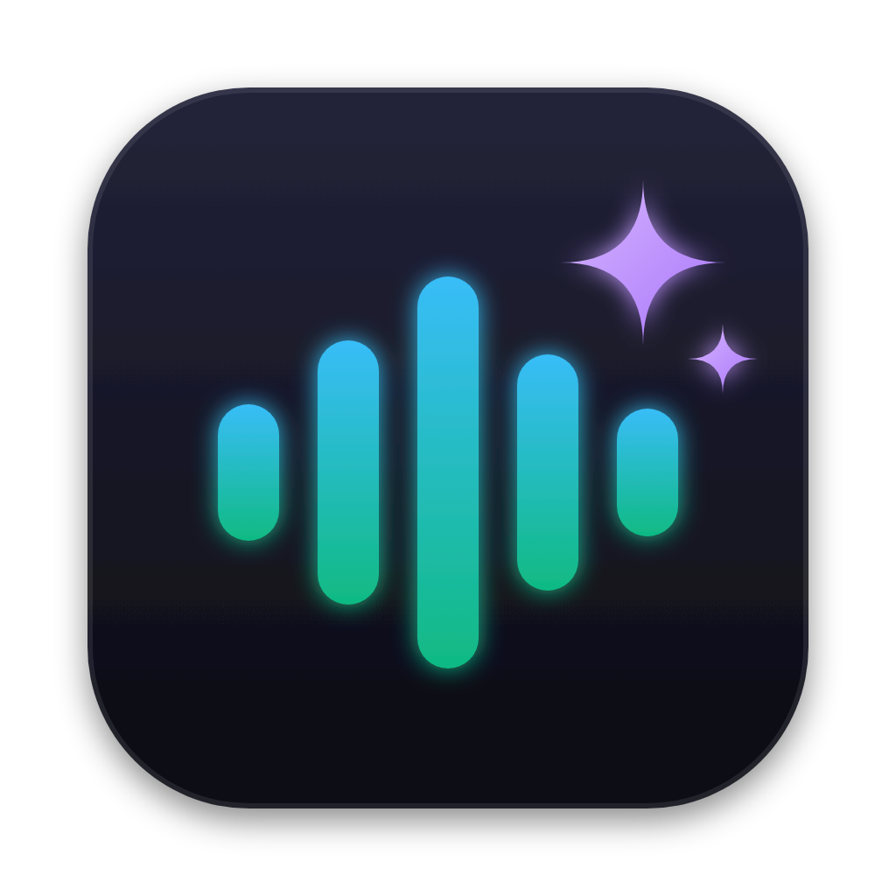

<p align="center"></p>

# VoiceLoggerMac

[English](README.md) | [Español](README.es.md)

App local para macOS que transcribe reuniones y contenido en tiempo real (Zoom, Teams, Meet, DingTalk, YouTube, etc.) sin enviar audio a la nube.

Usa **MLX Whisper** en Apple Silicon, captura de audio del sistema con **ScreenCaptureKit** (helper en Swift) o micrófono, segmentación por voz (VAD), subtítulos flotantes, alertas por palabras clave, historial exportable y **resumen IA local** con Qwen.


## App nativa (SwiftUI) — nueva

En `native/` está la versión nativa para macOS, pensada para leer durante la reunión:

- **Diseño para leer**: barra superior de una sola línea; transcripción a la izquierda; **Resumen IA** y **Preguntas** apilados a la derecha (todo redimensionable).
- **Resumen IA en vivo** cada 15 s – 2 min, actualizado de forma incremental, con Qwen cargado una sola vez en memoria.
- **Preguntas clave detectadas en el audio**: tócalas para que la IA las responda, cópialas u oculta la lista con la **×**.
- **Pregunta lo que quieras** sobre la reunión, con **respuestas largas y detalladas** (por defecto) o cortas.
- **Reuniones largas sin llenar la RAM**: memoria de la reunión en disco + presupuesto fijo de tokens por prompt; Qwen se descarga solo tras un rato sin uso.
- **`qwen_context.txt`**: persona/contexto para la IA («You are an expert in …»).
- **Velocidad del texto en vivo** (Rápida / Normal / Precisa), tamaño de interfaz, letra de lectura, subtítulos flotantes, modo compacto, siempre encima, alertas, selector de modelos Whisper y Qwen, atajos de teclado.
- 100 % local: audio, transcripción e IA nunca salen de tu Mac.

Requisitos: macOS 15+, Apple Silicon, Xcode 16 (Swift 6). La parte de IA usa el entorno Python de este repo:

```bash
./setup.sh
cd native && swift run
```

Detalles, atajos y modelos: [native/README.md](native/README.md).

<!-- Pantallazos de la app real: captura la ventana (sin sombra) y descomenta abajo.
     mkdir -p docs/screenshots && screencapture -o -w docs/screenshots/main.png
<p align="center"></p>
-->

Las secciones siguientes describen la app original en Python/PySide6 (sigue disponible).

## Requisitos

- macOS 13 o superior, en **Apple Silicon** (M1/M2/M3/M4...). MLX no funciona en Intel.
- Xcode Command Line Tools: `xcode-select --install`
- [`uv`](https://docs.astral.sh/uv/getting-started/installation/): `brew install uv`
- Python 3.11 para el entorno virtual.
  > `setup.sh` pide Python 3.11 a `uv` (`uv venv --python 3.11`); `uv` lo encuentra o lo descarga automáticamente.
- Conexión a internet **solo la primera vez**, para descargar dependencias y modelos.

## Instalación

```bash
git clone https://github.com/JulianDataScienceExplorerV2/VoiceLoggerMAC.git
cd VoiceLoggerMAC
chmod +x setup.sh run.sh
./setup.sh
```

`setup.sh` hace 3 cosas:

1. Crea `.venv` con Python 3.11.
2. Instala las dependencias de `requirements.txt` (PySide6, numpy, scipy, sounddevice, mlx-whisper, mlx-lm).
3. Compila `swift/SystemAudioCapture.swift` a `.build/system_audio_capture` (el capturador de audio del sistema con ScreenCaptureKit).

## Ejecutar

```bash
open VoiceLoggerMac.app
```

o

```bash
./run.sh
```

o directamente:

```bash
.venv/bin/python main.py
```

## Permisos de macOS (importante)

Sin esto la app no puede capturar audio. Después de concederlos, **cierra y vuelve a abrir la app**.

1. **Audio del sistema** (para Zoom/Teams/Meet/YouTube...):
   `Ajustes del Sistema > Privacidad y Seguridad > Grabación de pantalla y audio del sistema` → activa **VoiceLoggerMac**.
   Si ejecutas desde Terminal, activa también **Terminal** (o tu terminal).
2. **Micrófono** (solo si eliges la fuente "Micrófono"):
   `Ajustes del Sistema > Privacidad y Seguridad > Micrófono` → activa **VoiceLoggerMac**.

## Modelos: no hay que descargarlos a mano

Los modelos se descargan **automáticamente desde Hugging Face la primera vez** que se usan y quedan en la caché local de Hugging Face (`~/.cache/huggingface/`). Después funcionan sin internet. La primera descarga puede tardar varios minutos y ocupar unos pocos GB en total.

### Transcripción (Whisper MLX)

El modelo por defecto es `mlx-community/whisper-large-v3-turbo-q4` (equilibrio recomendado entre calidad y consumo). Puedes cambiarlo en la GUI, en "MODELO WHISPER (MLX)":

| Opción en la GUI | Repo en Hugging Face |
|---|---|
| Whisper Large v3 Turbo Q4 (recomendado) | `mlx-community/whisper-large-v3-turbo-q4` |
| Whisper Large v3 Turbo (máxima calidad) | `mlx-community/whisper-large-v3-turbo` |
| Whisper Small English (ligero) | `mlx-community/whisper-small.en-mlx` |
| Whisper Base English (ultra ligero) | `mlx-community/whisper-base.en-mlx` |
| Whisper Tiny (solo pruebas) | `mlx-community/whisper-tiny` |

Al cambiar de modelo, la primera transcripción con ese modelo tardará más porque lo descarga/carga.

Idiomas disponibles en la GUI: Inglés, Auto-detectar, Español, Portugués.

### Resumen IA (Qwen local)

El botón "Resumen IA" usa `mlx-community/Qwen2.5-1.5B-Instruct-4bit` (definido en `summarizer.py`). También se descarga solo la primera vez que pulsas el botón.

### Contexto para la IA (`qwen_context.txt`)

Los resúmenes y respuestas anteponen el texto de `qwen_context.txt` (raíz del repo) como system prompt,
p. ej. `You are an expert in data analytics…`. Se crea desde `qwen_context.example.txt` la primera vez,
se relee en cada petición y no se sube a git (puede tener nombres o proyectos privados). Se ignoran las
líneas que empiezan por `#` y las que aún tengan `XXXX`.

### Descarga manual opcional (pre-descargar)

Si prefieres descargar los modelos antes de abrir la app:

```bash
.venv/bin/python -c "from huggingface_hub import snapshot_download; snapshot_download('mlx-community/whisper-large-v3-turbo-q4')"
.venv/bin/python -c "from huggingface_hub import snapshot_download; snapshot_download('mlx-community/Qwen2.5-1.5B-Instruct-4bit')"
```

## Uso básico

1. Elige la fuente: **Audio del sistema** o **Micrófono**.
2. Elige modelo Whisper e idioma.
3. (Opcional) Escribe vocabulario/contexto: nombres, productos, jerga. Ayuda a que Whisper acierte palabras.
4. Ajusta la sensibilidad de voz si se corta o si entra ruido.
5. Pulsa **Iniciar escucha**. **Subtítulos** muestra la ventana flotante con las últimas frases.
6. Puedes activar **alertas** con palabras clave (ej: `julian, deadline, urgente`).
7. **Guardar TXT** (Cmd+S), **Copiar todo**, **Resumen IA** e **Historial** (exporta a Markdown o PDF).

Los logs se guardan localmente en `logs/transcripcion_AAAA-MM-DD.txt` y `.jsonl`.

## Privacidad

- Todo se procesa en tu Mac: audio, transcripción y resumen no salen a ningún servidor.
- Las transcripciones son contenido privado de tus reuniones. El `.gitignore` ya excluye `logs/`, `.venv/`, `.build/` y cachés, pero **no compartas la carpeta `logs/` ni subas exports con transcripciones reales**.

## Estructura

```
.
├── main.py               # Punto de entrada
├── app_gui.py            # Interfaz PySide6 (ventana, overlay, alertas, historial)
├── audio_capture.py      # Captura sistema/micrófono + segmentación VAD
├── transcriber.py        # Transcripción con MLX Whisper
├── summarizer.py         # Resumen IA local con Qwen (mlx-lm)
├── meeting_memory.py     # Memoria en disco de la reunión para la IA (búsqueda BM25)
├── logger.py             # Guardado TXT/JSONL en logs/
├── history_dialog.py     # Historial y exportación MD/PDF
├── benchmark.py          # Benchmark de modelos Whisper
├── swift/                # Helper ScreenCaptureKit
├── VoiceLoggerMac.app/   # Lanzador de la app para macOS
├── setup.sh              # Instalación (venv + dependencias + helper Swift)
└── run.sh                # Abre la app
```

## Benchmark (opcional)

Compara velocidad/RAM de los modelos Whisper con un WAV de prueba:

```bash
.venv/bin/python benchmark.py --audio /tmp/vl_bench.wav
```

## Pruebas reales (sin datos personales)

Probado en 2026 en un MacBook Pro con **Apple M3 Pro**, usando **solo audio sintético** (texto a voz de macOS `say`, sin reuniones reales ni datos personales publicados).

**Prueba de precisión sintética** — un clip TTS de 13,0 s con una frase conocida fue transcrito tal cual por el modelo por defecto (`whisper-large-v3-turbo-q4`) en 4,01 s incluyendo la carga del modelo (RTF 0,308). Los logs de uso real (216 bloques en una reunión) **no** se publicaron, solo se contaron.

**Benchmark (`benchmark.py`, WAV sintético)** — sin avisos térmicos antes ni después:

| Modelo | Audio | Cold | Warm | RTF | RAM máx. |
|---|---|---|---|---|---|
| Turbo Q4 | 10 s | 1,81 s | 0,72 s | 0,072 | 0,74 GB |
| Turbo Q4 | 30 s | 1,25 s | 0,79 s | 0,026 | 0,75 GB |
| Turbo | 10 s | 1,44 s | 0,78 s | 0,077 | 1,72 GB |
| Turbo | 30 s | 1,10 s | 0,80 s | 0,027 | 1,73 GB |

Las ejecuciones en caliente son ~13–38× más rápidas que el tiempo real, así que la captura en vivo no es el cuello de botella en chips M.

**Pruebas de humo (superadas):** `py_compile` en todos los módulos; el logger escribe TXT/JSONL en un directorio temporal; `PhraseSegmenter` detecta exactamente 1 frase en silencio + ruido sintético.

Reproduce la prueba sintética:

```bash
say -v Samantha -r 160 -o /tmp/vl_bench.aiff "Hello, this is a synthetic test. Voice Logger Mac transcribes meetings locally, without sending audio to the cloud."
afconvert -f WAVE -d LEI16@16000 /tmp/vl_bench.aiff /tmp/vl_bench.wav
.venv/bin/python benchmark.py --audio /tmp/vl_bench.wav --models Turbo-Q4,Turbo
```

## Proyectos similares y roadmap

Ya existen herramientas similares — por ejemplo **MacWhisper** y **Superwhisper** (comerciales, Whisper local + reuniones), **Buzz** (open source, transcripción de archivos + en vivo) y apps locales open source como **Meetily**, **Tacet** y **MeetScribe** (ScreenCaptureKit + Whisper). El nicho de VoiceLoggerMac es una app ligera, 100% local, en PySide6, con subtítulos PiP en vivo, alertas por palabras clave y resumen local con Qwen.

Mejoras planificadas:

- Etiquetas de hablante (sistema = ellos, micrófono = tú) y diarización opcional
- Acta final guardada sola al terminar la reunión; tareas a Recordatorios de Apple
- Búsqueda en reuniones pasadas; subtítulos traducidos en vivo
- Exportar a subtítulos SRT/VTT e importar/transcribir archivos de audio
- `.app` firmada / DMG para la app nativa; Foundation Models de Apple como alternativa a Qwen

## Problemas frecuentes

- **"No se encontró el capturador de audio"** → ejecuta `./setup.sh` para compilar `.build/system_audio_capture`.
- **macOS bloquea la captura** → revisa los permisos de la sección anterior y reinicia la app.
- **La primera transcripción tarda mucho** → está descargando el modelo de Whisper. Es normal, solo pasa una vez por modelo.
- **Error con el resumen (`mlx_lm` no instalado)** → reinstala dependencias: `uv pip install --python .venv/bin/python -r requirements.txt` (incluye `mlx-lm`).
- **Error de Python en `setup.sh`** → ejecuta `uv python install 3.11` y vuelve a intentarlo.
- **No detecta la voz / entra ruido** → sube/baja la sensibilidad (VAD) en la GUI y prueba el filtro "Claridad de voz" con micrófono.
