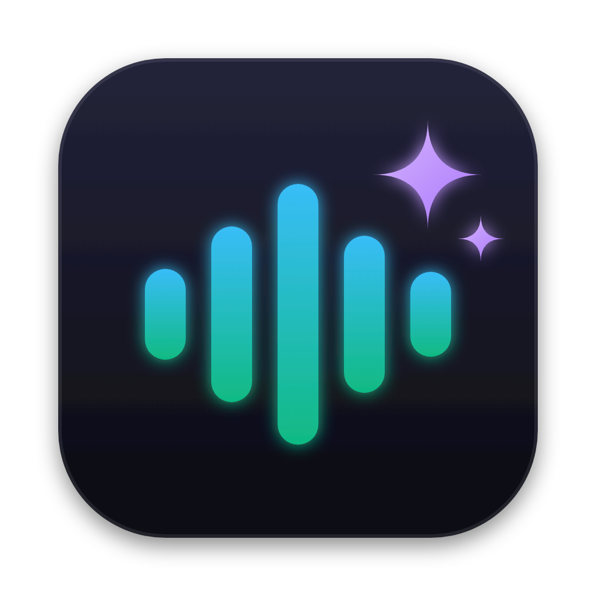
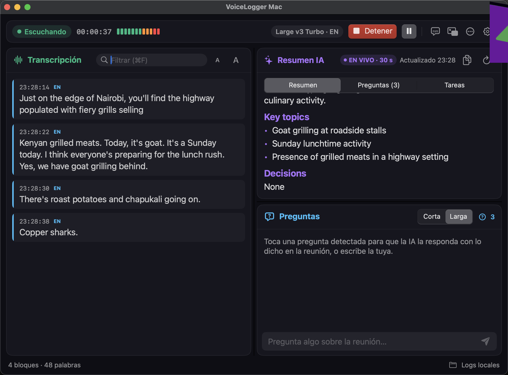
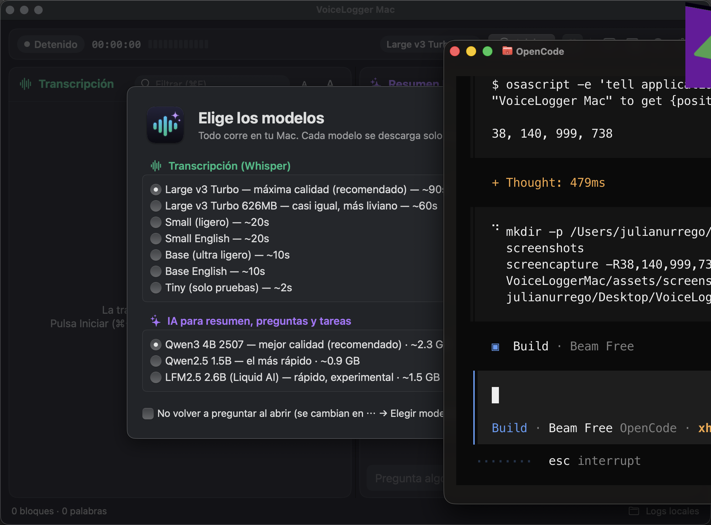

<p align="center"></p>

# VoiceLoggerMac

> Live transcription of meetings locally with AI for Mac (Apple Silicon).

[English](README.md) | [Español](README.es.md)

Local macOS app that transcribes meetings and content in real time (Zoom, Teams, Meet, DingTalk, YouTube, etc.) without sending audio to the cloud.

It uses **MLX Whisper** on Apple Silicon, system-audio capture via **ScreenCaptureKit** (Swift helper) or microphone, voice-activity segmentation (VAD), a floating caption overlay, keyword alerts, exportable history, and a **local AI summary** with Qwen.


## Native app (SwiftUI) — new

`native/` holds a native macOS version built for reading during the meeting:

- **Reading-first layout**: one-line toolbar; transcript on the left; **AI summary** and **Questions** stacked on the right (all resizable).
- **Live AI summary** every 15 s – 2 min, updated incrementally with Qwen loaded once in memory.
- **Key questions detected in the audio**: click one to get an answer, copy it, or hide the list with **×**.
- **Ask anything** about the meeting, with **long, detailed answers** (default) or short ones.
- **Long meetings without filling your RAM**: on-disk meeting memory + fixed token budgets per prompt; Qwen unloads itself when idle.
- **`qwen_context.txt`**: persona/context for the AI (“You are an expert in …”).
- **Live text speed** (Fast / Normal / Precise), interface size, reading font, floating captions, compact mode, always on top, keyword alerts, Whisper and Qwen model pickers, keyboard shortcuts.
- **Summary tabs**: Summary (default) · Questions · Tasks.
- 🌐 **Extend with the web** (optional, per answer): searches only the question text on DuckDuckGo/Wikipedia (plus your preferred sites with `site:`), puts reliable sources first, reads the best pages and cites sources.
- Local: audio, transcript and AI stay on your Mac (only the 🌐 button sends the question text to a search engine).

Requirements: macOS 15+, Apple Silicon, Xcode 16 (Swift 6). The AI side reuses this repo's Python environment:

```bash
./setup.sh
cd native && swift run
```

To open it with a double click (no Terminal), with its icon and Reminders support: `native/package.sh --install` (or `--dmg` to share). When a meeting stops, the app offers to add the detected tasks to Apple Reminders, and ⋯ → *Export meeting (Markdown)* works with Obsidian/Notion.

Details, shortcuts and model options: [native/README.md](native/README.md).

<!-- Screenshots of the real app: capture the window (no shadow) and uncomment below.
     mkdir -p docs/screenshots && screencapture -o -w docs/screenshots/main.png
<p align="center"></p>
-->

The sections below describe the original Python/PySide6 app (still supported).

## Requirements

- macOS 13 or newer on **Apple Silicon** (M1/M2/M3/M4...). MLX does not work on Intel.
- Xcode Command Line Tools: `xcode-select --install`
- [`uv`](https://docs.astral.sh/uv/getting-started/installation/): `brew install uv`
- Python 3.11 for the virtual environment.
  > `setup.sh` asks `uv` for Python 3.11 (`uv venv --python 3.11`); `uv` finds it or downloads it automatically.
- An internet connection **only the first time**, to download dependencies and models.

## Installation

```bash
git clone https://github.com/JulianDataScienceExplorerV2/VoiceLoggerMAC.git
cd VoiceLoggerMAC
chmod +x setup.sh run.sh
./setup.sh
```

`setup.sh` does 3 things:

1. Creates `.venv` with Python 3.11.
2. Installs the dependencies from `requirements.txt` (PySide6, numpy, scipy, sounddevice, mlx-whisper, mlx-lm).
3. Compiles `swift/SystemAudioCapture.swift` to `.build/system_audio_capture` (the ScreenCaptureKit system-audio capturer).

## Running

```bash
open VoiceLoggerMac.app
```

or

```bash
./run.sh
```

or directly:

```bash
.venv/bin/python main.py
```

## macOS permissions (important)

Without these, the app cannot capture audio. After granting them, **quit and reopen the app**.

1. **System audio** (for Zoom/Teams/Meet/YouTube...):
   `System Settings > Privacy & Security > Screen Recording & System Audio Recording` → enable **VoiceLoggerMac**.
   If you run it from Terminal, also enable **Terminal** (or your terminal app).
2. **Microphone** (only if you choose the "Microphone" source):
   `System Settings > Privacy & Security > Microphone` → enable **VoiceLoggerMac**.

## Models: no manual download needed

Models are downloaded **automatically from Hugging Face the first time** they are used and kept in the local Hugging Face cache (`~/.cache/huggingface/`). After that they work offline. The first download can take several minutes and a few GB in total.

### Transcription (Whisper MLX)

The default model is `mlx-community/whisper-large-v3-turbo-q4` (recommended balance of quality and power consumption). You can change it in the GUI, under "WHISPER MODEL (MLX)":

| GUI option | Hugging Face repo |
|---|---|
| Whisper Large v3 Turbo Q4 (recommended) | `mlx-community/whisper-large-v3-turbo-q4` |
| Whisper Large v3 Turbo (best quality) | `mlx-community/whisper-large-v3-turbo` |
| Whisper Small English (lightweight) | `mlx-community/whisper-small.en-mlx` |
| Whisper Base English (ultra lightweight) | `mlx-community/whisper-base.en-mlx` |
| Whisper Tiny (testing only) | `mlx-community/whisper-tiny` |

When you switch models, the first transcription with that model will take longer because it downloads/loads it.

Languages available in the GUI: English, Auto-detect, Spanish, Portuguese.

### AI summary (local Qwen)

The "AI Summary" button uses `mlx-community/Qwen2.5-1.5B-Instruct-4bit` (defined in `summarizer.py`). It is also downloaded only the first time you press the button.

### Context file for the AI (`qwen_context.txt`)

Summaries and answers prepend the text in `qwen_context.txt` (repo root) as a system prompt, e.g.
`You are an expert in data analytics…`. It is created from `qwen_context.example.txt` the first time,
is re-read on every request and is git-ignored (it may contain private names/projects). Lines starting
with `#` and lines still containing `XXXX` are ignored.

### Optional manual download (pre-download)

If you prefer to download the models before opening the app:

```bash
.venv/bin/python -c "from huggingface_hub import snapshot_download; snapshot_download('mlx-community/whisper-large-v3-turbo-q4')"
.venv/bin/python -c "from huggingface_hub import snapshot_download; snapshot_download('mlx-community/Qwen2.5-1.5B-Instruct-4bit')"
```

## Basic usage

1. Choose the source: **System audio** or **Microphone**.
2. Choose the Whisper model and language.
3. (Optional) Enter vocabulary/context: names, products, jargon. This helps Whisper get words right.
4. Adjust voice sensitivity if speech gets cut off or noise comes through.
5. Click **Start listening**. **Captions** shows the floating window with the latest phrases.
6. You can enable **alerts** with keywords (e.g. `julian, deadline, urgent`).
7. **Save TXT** (Cmd+S), **Copy all**, **AI Summary**, and **History** (exports to Markdown or PDF).

Logs are saved locally in `logs/transcripcion_YYYY-MM-DD.txt` and `.jsonl`.

## Privacy

- Everything is processed on your Mac: audio, transcription, and summaries never leave your machine.
- Transcripts are private meeting content. The `.gitignore` already excludes `logs/`, `.venv/`, `.build/`, and caches, but **do not share the `logs/` folder or upload exports with real transcripts**.

## Project structure

```
.
├── main.py               # Entry point
├── app_gui.py            # PySide6 GUI (window, overlay, alerts, history)
├── audio_capture.py      # System/microphone capture + VAD segmentation
├── transcriber.py        # MLX Whisper transcription
├── summarizer.py         # Local AI summary with Qwen (mlx-lm)
├── meeting_memory.py     # On-disk meeting memory for the AI (BM25 retrieval)
├── web_search.py         # Optional web search for "Extend with the web" (DuckDuckGo/Wikipedia)
├── logger.py             # TXT/JSONL logging in logs/
├── history_dialog.py     # History and MD/PDF export
├── benchmark.py          # Whisper model benchmark
├── swift/                # ScreenCaptureKit helper
├── VoiceLoggerMac.app/   # macOS app launcher
├── setup.sh              # Setup (venv + dependencies + Swift helper)
└── run.sh                # Opens the app
```

## Benchmark (optional)

Compare Whisper model speed/RAM with a test WAV file:

```bash
.venv/bin/python benchmark.py --audio /tmp/vl_bench.wav
```

## Real-world testing (no personal data)

Tested in 2026 on a MacBook Pro with **Apple M3 Pro**, using **synthetic audio only** (macOS `say` text-to-speech, no real meetings, no personal data published).

**Synthetic accuracy test** — a 13.0 s TTS clip with a known phrase was transcribed verbatim by the default model (`whisper-large-v3-turbo-q4`) in 4.01 s including model load (RTF 0.308). Session logs from real use (216 blocks in one meeting) were **not** published, only counted.

**Benchmark (`benchmark.py`, synthetic WAV)** — no thermal warnings before or after:

| Model | Audio | Cold | Warm | RTF | Peak RAM |
|---|---|---|---|---|---|
| Turbo Q4 | 10 s | 1.81 s | 0.72 s | 0.072 | 0.74 GB |
| Turbo Q4 | 30 s | 1.25 s | 0.79 s | 0.026 | 0.75 GB |
| Turbo | 10 s | 1.44 s | 0.78 s | 0.077 | 1.72 GB |
| Turbo | 30 s | 1.10 s | 0.80 s | 0.027 | 1.73 GB |

Warm runs are ~13–38× faster than real time, so live capture is not the bottleneck on M-series chips.

**Smoke tests (passed):** `py_compile` on all modules; logger writes TXT/JSONL to a temp dir; `PhraseSegmenter` detects exactly 1 phrase in synthetic silence + noise.

Reproduce the synthetic test:

```bash
say -v Samantha -r 160 -o /tmp/vl_bench.aiff "Hello, this is a synthetic test. Voice Logger Mac transcribes meetings locally, without sending audio to the cloud."
afconvert -f WAVE -d LEI16@16000 /tmp/vl_bench.aiff /tmp/vl_bench.wav
.venv/bin/python benchmark.py --audio /tmp/vl_bench.wav --models Turbo-Q4,Turbo
```

## Similar projects & roadmap

Similar tools exist — e.g. **MacWhisper** and **Superwhisper** (commercial, local Whisper + meetings), **Buzz** (open source, file + live transcription), and open-source local-first apps like **Meetily**, **Tacet**, and **MeetScribe** (ScreenCaptureKit + Whisper). VoiceLoggerMac's niche is a lightweight, fully local, PySide6 app with live PiP captions, keyword alerts, and a local Qwen summary.

Planned improvements next:

- Speaker labels (system = them, mic = you) and optional diarization
- Final minutes saved automatically when a meeting ends; action items to Apple Reminders
- Search across past meetings; live translated captions
- Export to SRT/VTT subtitles and import/transcribe audio files
- Signed `.app` / DMG for the native app; Apple Foundation Models as an alternative to Qwen

## Troubleshooting

- **"Audio capturer not found"** → run `./setup.sh` to compile `.build/system_audio_capture`.
- **macOS blocks capture** → check the permissions in the section above and restart the app.
- **First transcription takes a long time** → it is downloading the Whisper model. This is normal, and only happens once per model.
- **Summary error (`mlx_lm` not installed)** → reinstall dependencies: `uv pip install --python .venv/bin/python -r requirements.txt` (includes `mlx-lm`).
- **Python error in `setup.sh`** → run `uv python install 3.11` and try again.
- **Voice not detected / too much noise** → raise/lower the VAD sensitivity in the GUI and try the "Voice clarity" filter with the microphone.

## Screenshots




## License

[MIT](LICENSE) © 2026 Julian Urrego.

The AI models are not part of this repository: each user downloads them from Hugging Face under their own
licenses (Whisper: MIT; Qwen2.5 / Qwen3: Apache 2.0; LFM2.5: LFM Open License 1.0). Main libraries:
WhisperKit (MIT), mlx-whisper / mlx-lm (MIT), PySide6 (LGPLv3).
